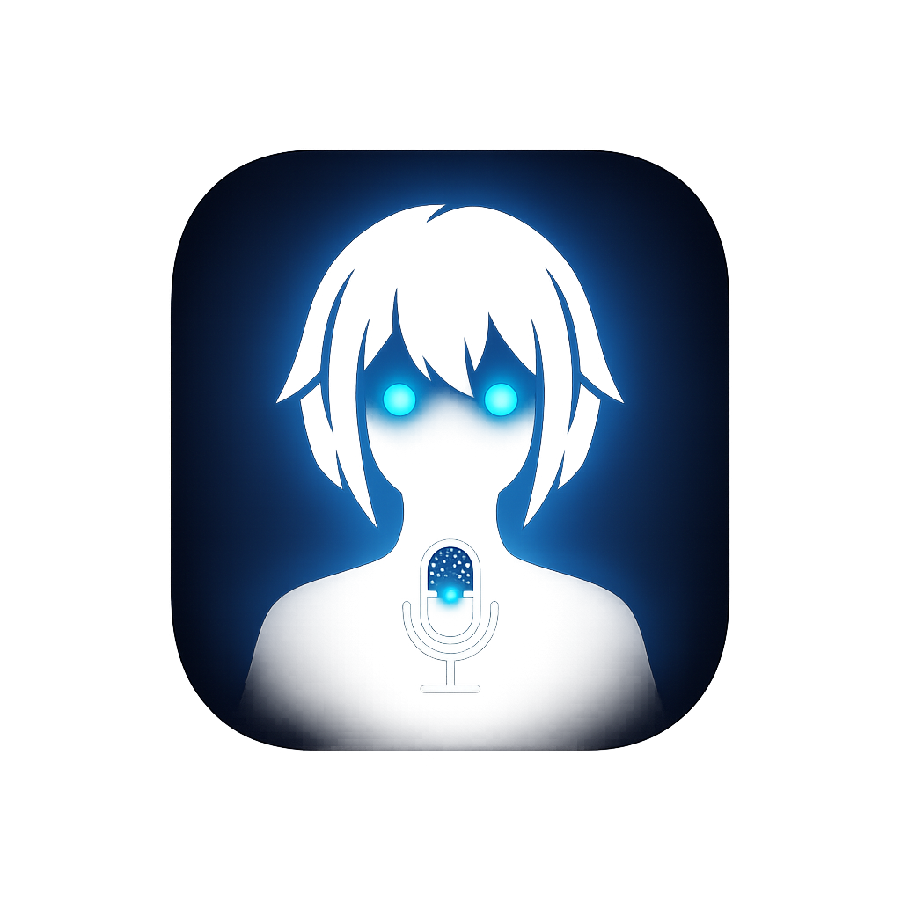

<p align="center">
  
</p>

<h1 align="center">🌸 Aoi (AI Hypr-Assistant)</h1>

<p align="center">
  <strong>Desktop AI Waifu Companion interaktif, super ringan, dan cerdas yang dirancang khusus untuk Linux (Arch Linux / CachyOS) dengan Wayland & Hyprland compositor.</strong>
</p>

<p align="center">
  
  
  
  
  
  
</p>

---

## 🌟 Tentang Aoi

**Aoi** adalah asisten desktop AI virtual berbasis avatar sprite 2D yang melayang di atas layar desktop Hyprland Anda. Aoi dapat mendengarkan perintah suara Anda, berpikir menggunakan Large Language Model (LLM) pilihan Anda, membalas dengan suara wanita dewasa yang lembut (*mommy vibe*), serta mengeksekusi perintah terminal sistem secara aman dengan konfirmasi interaktif.

### ✨ Fitur Unggulan

- 🎭 **Interactive 2D Sprite Avatar**:
  - Avatar responsif dengan berbagai ekspresi (*Idle, Blinking, Listening, Thinking, Speaking, Confirmation, Error*).
  - Avatar dapat di-klik dan digeser (*drag & drop*) ke mana saja di layar.
  - **Double-click** pada avatar untuk menyembunyikan (*hide*) atau menampilkannya kembali.
  - Sistem Multi-Preset: Mendukung impor & ekspor preset avatar kustom dalam format paket ZIP.
- 🔊 **Offline TTS Berkualitas Tinggi (Mommy Voice)**:
  - Menggunakan engine **Piper TTS** secara lokal tanpa ketergantungan internet.
  - Model suara bawaan: `en_US-lessac-high` yang di-tuning khusus (*length_scale: 1.15*) untuk menghasilkan intonasi wanita dewasa yang tenang, ramah, dan mengayomi (*caring mommy persona*).
  - Pilihan engine suara lain: Edge-TTS (online gratis), ElevenLabs, OpenAI Speech, dan Fish Audio.
- 🎙️ **Speech-to-Text (STT)**:
  - Dukungan Whisper.cpp lokal dan endpoint cloud untuk pengenalan suara instan.
- 🧠 **Dukungan Multi-Provider LLM**:
  - **Google Gemini** (`gemini-2.0-flash`, `gemini-1.5-pro`, dll.)
  - **Groq** (inferensi super cepat `llama-3.3-70b-versatile`)
  - **OpenAI** (`gpt-4o`, `gpt-4o-mini`)
  - **OpenRouter** & **Ollama** (100% model lokal)
  - **Custom OpenAI-Compatible API** (kompatibel dengan DeepSeek, vLLM, LM Studio, Ollama)
- 🖥️ **Integrasi Native Hyprland & IPC Unix Socket**:
  - Jendela transparan tanpa dekorasi/border yang tetap di atas (*pinned & floating*).
  - Terintegrasi dengan socket Unix (`/tmp/ai-assistant.sock`) untuk kontrol langsung via shortcut keyboard Hyprland.
  - Bash Command Executor dengan dialog konfirmasi keamanan (Ya/Tidak).
- ⚙️ **Panel Pengaturan Modern**:
  - Jendela konfigurasi intuitif untuk mengatur API key, model, avatar, kecepatan bicara, hingga kepribadian AI.

---

## 📋 Prasyarat Sistem

Aplikasi ini dioptimalkan untuk distribusi berbasis Arch Linux (seperti **CachyOS**, **Arch Linux**, **EndeavourOS**) dengan **Hyprland** (Wayland).

### 1. Paket Dependensi Sistem
Pasang dependensi kompilasi Tauri, WebKitGTK, audio, dan IPC:

```bash
sudo pacman -S --needed \
    base-devel \
    curl \
    wget \
    file \
    openssl \
    webkit2gtk-4.1 \
    libayatana-appindicator \
    librsvg \
    socat \
    ffmpeg \
    alsa-utils \
    nodejs \
    npm \
    rust
```

*(Jika menggunakan CachyOS/Arch, pastikan rustup atau rust toolchain sudah terpasang dan mutakhir)*.

---

## 🚀 Panduan Instalasi Langkah-demi-Langkah

### Langkah 1: Kloning Repositori
```bash
git clone https://github.com/Rasshqa/Aoi-AI-Assistant.git
cd Aoi-AI-Assistant
```

### Langkah 2: Instal Dependensi Node.js
```bash
npm install
```

### Langkah 3: Setup Piper TTS & Unduh Model Suara (Mommy Lessac)

Aoi menggunakan Piper TTS untuk menghasilkan suara offline yang cepat dan alami. Jalankan perintah berikut untuk mengunduh binary Piper dan model suara:

```bash
# 1. Buat direktori penyimpanan
mkdir -p ~/.local/share/piper ~/.local/bin

# 2. Unduh Piper Standalone (jika belum terpasang di sistem)
cd /tmp
wget -O piper_linux_x86_64.tar.gz https://github.com/rhasspy/piper/releases/download/2023.11.14-2/piper_linux_x86_64.tar.gz
tar -xzf piper_linux_x86_64.tar.gz
cp -r piper/* ~/.local/share/piper/
ln -sf ~/.local/share/piper/piper ~/.local/bin/piper
chmod +x ~/.local/bin/piper

# 3. Unduh Model Suara en_US-lessac-high (Mommy Voice)
wget -O ~/.local/share/piper/mommy_lessac.onnx \
  https://huggingface.co/rhasspy/piper-voices/resolve/v1.0.0/en/en_US/lessac/high/en_US-lessac-high.onnx

wget -O ~/.local/share/piper/mommy_lessac.onnx.json \
  https://huggingface.co/rhasspy/piper-voices/resolve/v1.0.0/en/en_US/lessac/high/en_US-lessac-high.onnx.json

# 4. Terapkan Tuning Intonasi Dewasa/Mommy (length_scale: 1.15)
python3 -c "
import json
p = '$HOME/.local/share/piper/mommy_lessac.onnx.json'
with open(p, 'r') as f:
    d = json.load(f)
d.setdefault('inference', {})['length_scale'] = 1.15
d['inference']['noise_scale'] = 0.667
d['inference']['noise_w'] = 0.8
with open(p, 'w') as f:
    json.dump(d, f, indent=2)
print('✅ Tuning model suara selesai!')
"
```

> **Catatan:** Pastikan `~/.local/bin` ada di dalam `$PATH` Anda (biasanya sudah ada di `~/.bashrc` atau `~/.zshrc`).

### Langkah 4: Jalankan Skrip Instalasi Helper

Jalankan skrip `install.sh` untuk menyiapkan desktop launcher dan direktori konfigurasi:

```bash
chmod +x install.sh
./install.sh
```

### Langkah 5: Tambahkan Konfigurasi ke Hyprland

Buka konfigurasi Hyprland Anda (`~/.config/hypr/hyprland.conf`) dan tambahkan aturan jendela serta shortcut berikut:

```ini
# ==============================================================================
# Konfigurasi Aoi (AI Hypr-Assistant)
# ==============================================================================

# Aturan Jendela Overlay Aoi
windowrulev2 = float, title:^(AI Waifu Overlay)$
windowrulev2 = pin, title:^(AI Waifu Overlay)$
windowrulev2 = noborder, title:^(AI Waifu Overlay)$
windowrulev2 = noshadow, title:^(AI Waifu Overlay)$
windowrulev2 = noblur, title:^(AI Waifu Overlay)$
windowrulev2 = move 100%-360 100%-490, title:^(AI Waifu Overlay)$

# Aturan Jendela Pengaturan (Settings)
windowrulev2 = float, title:^(Aoi Settings)$
windowrulev2 = center, title:^(Aoi Settings)$
windowrulev2 = size 720 540, title:^(Aoi Settings)$

# Keybind Interaksi Cepat
bind = $mainMod, V, exec, echo "toggle_mic" | socat - UNIX-CONNECT:/tmp/ai-assistant.sock
bind = $mainMod, H, exec, echo "toggle_hide" | socat - UNIX-CONNECT:/tmp/ai-assistant.sock
bind = ALT, Y, exec, echo "confirm_yes" | socat - UNIX-CONNECT:/tmp/ai-assistant.sock
bind = ALT, N, exec, echo "confirm_no" | socat - UNIX-CONNECT:/tmp/ai-assistant.sock
```

Muat ulang konfigurasi Hyprland dengan:
```bash
hyprctl reload
```

---

## 🎮 Menjalankan Aplikasi

### Mode Pengembangan (Development)
Untuk menguji dan menjalankan aplikasi dengan live-reload:
```bash
npm run tauri dev
```

### Mode Kompilasi Rilis (Production Build)
Untuk membangun biner rilis mandiri (*standalone binary*):
```bash
npm run tauri build -- --no-bundle
```
Hasil biner akan berada di `src-tauri/target/release/ai-hypr-assistant`.

Jalankan kembali `./install.sh` agar binary terhubung ke `~/.local/bin/ai-hypr-assistant`, lalu Anda dapat menjalankannya langsung melalui launcher aplikasi (Rofi, Wofi, Walker, atau App Menu Hyprland Anda).

---

## ⌨️ Kontrol & Interaksi

| Aksi | Cara Penggunaan |
| :--- | :--- |
| **Pindahkan Avatar** | Klik kiri dan tahan (*drag*) avatar ke posisi mana pun di desktop. |
| **Sembunyikan / Tampilkan Avatar** | **Double-click** pada avatar, atau tekan `$mainMod + H`. |
| **Buka Pengaturan** | Klik kanan pada avatar atau klik ikon gear di sudut overlay. |
| **Toggle Mikrofon / Bicara** | Tekan `$mainMod + V` untuk mulai mendengarkan / berhenti. |
| **Setujui Perintah Sistem** | Tekan `ALT + Y` saat Aoi meminta izin menjalankan perintah bash. |
| **Tolak Perintah Sistem** | Tekan `ALT + N` untuk membatalkan perintah bash. |

---

## ⚙️ Konfigurasi (`~/.config/aoi/config.json`)

Konfigurasi disimpan secara otomatis di `~/.config/aoi/config.json`. Anda dapat mengubahnya melalui UI Pengaturan atau menyunting berkas JSON secara langsung:

```json
{
  "llm_provider": "gemini",
  "gemini_api_key": "AIzaSy...",
  "groq_api_key": "",
  "openai_api_key": "",
  "openrouter_api_key": "",
  "ollama_base_url": "http://localhost:11434",
  "model_name": "gemini-2.0-flash",
  "tts_engine": "piper",
  "tts_model_path": "/home/username/.local/share/piper/mommy_lessac.onnx",
  "whisper_model_path": "",
  "assistant_name": "Aoi",
  "user_name": "Kak",
  "personality_preset": "caring",
  "avatar_size": 144
}
```

### Variabel Lingkungan (Opsional)
Anda juga dapat mengekspor kunci API melalui shell profile (`~/.bashrc` atau `~/.zshrc`):
```bash
export GEMINI_API_KEY="kunci-gemini-anda"
export GROQ_API_KEY="kunci-groq-anda"
export OPENAI_API_KEY="kunci-openai-anda"
```

---

## ❓ FAQ & Troubleshooting

### Suara TTS Tidak Terdengar?
1. Pastikan biner `piper` dapat diakses di terminal dengan menjalankan:
   ```bash
   piper --version
   ```
2. Pastikan file model ONNX dan JSON ada di path yang sesuai:
   ```bash
   ls -la ~/.local/share/piper/mommy_lessac.onnx*
   ```
3. Pastikan audio server Anda (PipeWire atau PulseAudio) aktif:
   ```bash
   pactl info
   ```

### Avatar Menutupi Jendela Lain / Background Hitam?
- Pastikan compositor Hyprland aktif dan baris `windowrulev2` pada `hyprland.conf` sudah ditambahkan dengan benar.
- Muat ulang Hyprland dengan `hyprctl reload`.

### Shortcut Hyprland Tidak Merespons?
- Pastikan paket `socat` telah terpasang (`sudo pacman -S socat`).
- Pastikan aplikasi Aoi sedang berjalan sehingga socket `/tmp/ai-assistant.sock` aktif.

---

## 📄 Lisensi

Proyek ini dirilis di bawah lisensi [MIT](LICENSE). Dibuat dengan cinta untuk komunitas desktop Linux & Hyprland!
